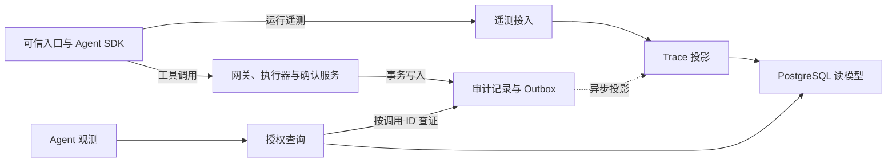

# Agent Tracing 系统架构

方案草案 · 2026-11-23

[系统架构图（在本地浏览器打开 HTML）](tracing-architecture.html)

## 1. 目标与一期范围

Agent 观测从会话列表进入，为开发者解释 Agent 如何运行，为安全管理员解释某次工具调用为何放行、拒绝或等待确认，以及平台能核实的实际执行结果。两类用户共用一次采集的数据，读取范围和内容权限由平台分别控制。

| 原型界面 | 一期数据契约 |
| --- | --- |
| Sessions 列表、搜索、时间分布 | 按 Session 开始时间、Agent、结果和关键字筛选。列表、总数和分布使用同一筛选口径。 |
| Session 详情 | 对话会话可含多个轮次。每轮一条 Trace。自主任务每次运行一条 Trace。只有一条时直接打开，多条时沿用详情容器按轮次切换。 |
| 时间线、调用树 | 同一批节点。时间线读取开始时间和耗时，调用树读取明确的父子关系。并行子 Agent 是同父节点下可时间重叠的分支。 |
| 调用详情 | Agent 节点显示运行元数据。LLM 显示模型、状态、耗时、可用的参数与 Token 用量。工具显示可信身份、网关决策、脱敏参数、策略版本、确认状态和执行证据。 |
| 工具调用与异常事件 | 以平台调用 ID 定位同一条 Trace 的工具节点。证据先可查、投影尚未就绪时，显示已知事实与同步状态。 |

一期先用网关调用打通查询和审计关联，再接 Agent SDK 补齐内部运行步骤。平台分别标明网关覆盖、已接入的 Agent 遥测和已知缺失。未观测到的内部步骤不生成节点；低覆盖也不降低安全决策或执行证据的可信度。财务演示可以开启合成 LLM 内容采集并标记为模拟。

## 2. 方案选择

| 方案 | 适用性与成本 |
| --- | --- |
| 只用网关记录 | 足够核查经过网关的工具调用。模型调用、并行子 Agent、应用最终输出缺少来源，无法覆盖原型的详情。 |
| 第三方 Tracing 作为主后端 | 可以复用遥测接入和观测数据模型。网关审计归责、租户隔离、内容授权以及待确认状态仍需由平台维护，两个数据面的查询和保留策略也需要协调。 |
| **推荐 · 标准遥测接入 + 平台 Trace 读模型** | Agent 侧复用 OpenTelemetry，平台保留业务关联、证据归责和授权。首期可在现有平台后端内交付，运维成本随真实负载评估。 |

Session／Trace／Span 的组织方式与 Langfuse 的 Session／Trace／Observation 对应。业务字段统一归一化，OTel 属性映射按版本测试，方便兼容 SDK 或后续对接外部观测后端。 [Langfuse 数据模型](https://langfuse.com/docs/observability/data-model) · [OpenTelemetry Span 规范](https://opentelemetry.io/docs/specs/otel/trace/api/)

## 3. 系统模块与写入流程

| 模块 | 责任与接口 |
| --- | --- |
| 业务关联 | 可信应用入口登记已认证的 Session 和轮次，发放绑定租户、环境、项目、根 Agent、轮次和 Trace 的短时效关联凭据。可信入口先用 OTel SDK 创建本轮根 Span，再于分派调用及导出遥测前登记 SDK 分配的 Trace ID，纯网关路径由网关创建和登记。已有平台会话凭据若能表达这些约束，可复用。关联凭据只用于关联，工具授权仍由网关判定。 |
| 遥测接入 | Agent SDK／编排器传播 W3C Trace Context，异步批报结束的 Span。采用鉴权的 OTLP/HTTP 接入，校验绑定关系、结构、大小和配额。调用名称、模型参数、可选内容按白名单归一化。 |
| Tooling Gateway、执行器与确认服务 | 按各自职责产生服务端证据。鉴权后记录会话、发起用户或工作负载、Agent、委托关系及实际下游执行主体。策略决策与生效版本由网关写入，确认和执行结果由各自的事实源写入。 |
| 审计记录与 Outbox | 执行侧的权威事实。用同一事务记录业务状态转移、对应审计事件和待投影记录。原事件追加保存，修正通过新事件表达。 |
| 投影 | 从已接收遥测及 Outbox 消费数据。处理幂等、乱序、受信来源优先级、树校验与摘要更新，在目标事务内提交读模型和消费去重记录。 |
| 查询 | 按访问范围读取会话、Trace、调用节点以及关联证据引用。SDK 和网关的协议适配、树组装和节点去重封装在写入或投影模块内，控制台消费统一视图。 |

**Agent 路径。** 可信入口登记根 Span 后，运行时沿用其上下文。在并行任务分派时各自捕获父上下文，子 Agent 和模型调用各自记录起止时间。网关调用可有 SDK 客户端 Span。异步投递不阻塞业务，接入端在完成脱敏并将接收批次可靠落库后确认。入站批次用工作负载身份鉴权，可以混合多条 Trace。接入对每个 Span 查可信登记，按生产者许可校验 Trace 归属和节点执行 Agent。关联凭据短时效用于业务请求，遥测重传按登记的接收窗口校验，两者独立。试点允许登记的最长运行期结束或可信终止后再收 48 小时，取两者较早的截止时间。首期接入端直接落库，单跳 OTLP 确认的含义限于该接收端。SDK 有界缓冲，遇可重试失败退避，缓冲耗尽或进程退出可能丢失遥测。接入返回 OTLP 的部分成功时记录拒绝项数量，整批不自动重传。 [OTLP 投递与确认](https://opentelemetry.io/docs/specs/otlp/)

**平台路径。** 网关生成平台调用 ID，持久化决策，允许执行时还要在实际转发前持久化执行意图。确认挂起时，确认记录保存调用 ID 和原 Trace 上下文；之后以锁定的参数、当前授权和有效期复验，领取成功后生成执行尝试。只读调用也记录放行和结果。观测投影停机可积压并重放。必需审计写入不可用时，网关对尚未发出的调用返回暂不可用，禁止转发并触发监控；已发出的调用可能只能标为结果未知并待对账。工具执行和数据库事务跨系统，按调用 ID 保存和查询执行尝试。副作用调用要求提供逻辑请求幂等键，平台在转发前原子写入幂等占位、平台调用 ID 和首条审计事件，按租户、环境、项目、已认证调用主体和该键去重，绑定原操作版本及规范化参数摘要。并发或超时后的同键重传返回同一个调用 ID 和状态；同键换参数或操作返回冲突。重传读取状态仍需鉴权。幂等记录从调用开始覆盖客户端重试窗口、确认有效期及结果未知的对账窗口，生命周期由执行侧管理。只有下游明确支持幂等及结果查询时才可用原调用 ID 按其契约恢复，其他情况保留未知并人工核验。

**异步确认。** 平台审计事件独立于 SDK 上报窗口。确认服务从确认单恢复原 Trace 及调用 ID，补写确认、复验与执行证据。调用有待确认或活跃对账时，保留原 Trace 的最小元数据和证据关联，截至确认或对账窗口结束后 7 天与常规元数据留存截止日两者中的较晚日期；内容仍按各自期限清除。确认和对账窗口由平台策略配置有限的期限。超期到达的审计证据仍按原调用 ID 查阅，已过期或主动删除的 Trace 不重新生成。

**关联路径。** 网关先完成身份校验，再用业务关联凭据验证会话归属，再接受有效的 `traceparent` 作为拓扑信息。只接网关且已有可信会话和轮次时，为该轮创建网关 Trace。若可信会话存在但轮次不可用，每个独立调用创建一条 Trace。若会话也不可用，按已认证调用生成独立的网关会话，杜绝按时间或展示名猜测归并。未认证请求记录在网关安全日志，缺少可信归属时无需生成会话。跨组织信任边界时重启追踪上下文，禁止向未经允许的外部端点透传内部业务关联标识。 [W3C Trace Context](https://www.w3.org/TR/trace-context/)

## 4. 数据模型与运行语义

所有观测记录以服务端确定的 `tenant_id`、`environment_id` 和 `project_id` 为隔离范围。会话归属单一项目，项目内根 Agent 和会话在首条可信登记时确定。不同项目之间的运行分别建立 Trace，一期只在各自项目内展示节点。MCP 协议会话 ID 与业务会话 ID 分开。

| 对象 | 关键字段与不变量 |
| --- | --- |
| Session | 平台 `session_id`、根 Agent、发起用户或工作负载、开始与末次活动时间、可见调用数、结果摘要、覆盖来源。开始时间由可信入口登记，纯网关会话取服务端首次登记时间，写入后固定，迟到记录不修改。外部会话引用按可信入口命名空间管理。 |
| Trace | `trace_id`、`session_id`、`turn_id` 或 `run_id`、起止时间、应用运行状态、治理摘要、覆盖状态。业务绑定在所属项目内唯一。可另存来自可信入口的 `task_id`／`correlation_id`，用于在授权范围内关联同一业务任务的多轮运行。 |
| Span | `trace_id`、`span_id`、`parent_span_id`、类型、时间、来源、可核验的执行 Agent、状态与安全元数据。类型先支持 Agent、LLM、工具调用、网关执行、确认。 |
| Tool Call | 平台 `call_id`、可信 Trace 与网关节点引用、工具及操作版本、发起用户或工作负载、Agent、委托链与实际下游执行主体、授权 ID/权限 epoch、凭证引用和受众、资源或目的地摘要、敏感标签、决策与原因、命中策略版本、确认单 ID。凭证引用不含秘密。一个调用可有多次执行尝试。 |
| Confirmation | `confirmation_id`、`call_id`、状态、有效期、确认人及动作时间。原 Trace 引用随确认单保存。 |
| Execution Attempt | `attempt_id`、`call_id`、下游请求引用、执行状态、后端回执或独立对账证据引用及来源。财务 Demo 以原付款调用 ID 关联测试付款端的入站记录和测试交易。 |
| Audit Event | `event_id`、事实源、`call_id`、可选 `attempt_id`、事件类型、源端序号、发生和接收时间、状态及证据引用。原始事件与投影独立保留。 |
| Span Content | 节点引用、内容类型、脱敏版本、长度、采集状态、到期时间。独立加密保存经批准的脱敏内容。 |

- **去重。** 遥测重试按租户范围、登记的生产者和 Span 标识识别，第一次合法接收后固化节点来源。不同生产者声明同一 Trace 中的同一节点 ID，或重传与已接收元数据实质冲突时拒绝并记录诊断。平台事件按事实源和事件 ID 去重。投影在目标库提交结果和去重记录后才确认源记录。确认失败时重读，去重防止重复节点或计数。已确认接收的暂存记录只在投影已提交并确认后按暂存策略清理，积压超出目标时先限流并告警。不可投影的记录隔离为最小脱敏诊断并告警。
- **关联。** 每个 SDK 工具调用可带父上下文，网关回传 `call_id`。同一调用的 SDK 客户端节点与网关节点，只有在平台登记的 Trace、发起 Agent 及网关记录的上游父上下文吻合时，才归为同一个主视图工具节点。SDK 可补客户端耗时；网关拥有决策及执行证据。无法安全关联时分开展示来源，统计只按可见平台 `call_id` 去重。
- **建树和时间。** 父节点迟到时先将已接收节点显示在未关联区，之后自动归并；父节点限同一 Trace，并拒绝自引用和环。跨 Trace 的独立运行使用 Trace Links，查询时对两端分别检查访问范围。时间线用来源提供的 UTC 时间排序，用同一进程的耗时计量确定节点宽度。跨进程时钟偏差时保留原始记录并标识。Trace 耗时使用根运行区间，根缺失时只显示已观测时间区间；并行耗时不累加。 [OpenTelemetry Trace 模型与 Links](https://opentelemetry.io/docs/specs/otel/overview/)
- **决策、执行和运行状态分别归责。** `decision` 记录允许、拒绝、阻断或待确认；`execution` 记录未执行、执行中、成功、失败或未知；`run_state` 来自 Agent 或可信入口的运行事件。收到了拒绝且无后续执行权限时可标为未执行；网络超时、结果回执缺失时标为未知。独立的 `confirmation_state` 由确认服务维护，包含待确认、已确认、已拒绝、已过期。确认同意后，网关另写复验结果，执行器按尝试写执行结果。同一事实源内用对象序号归并；跨来源用确认单、调用与尝试关系及状态机推导，保留原始决策。
- **摘要与覆盖分开。** 列表结果和结果筛选使用同一个字段。只看当前读者可见且留存期内的事实，依次取已阻断、已拒绝、仍待确认。复验阻断或拒绝以网关事实为准，确认拒绝或过期归入已拒绝。只有确认单当前为待处理时才计作待确认。没有以上结果时，显示最近一条可见 Trace 的运行状态。只有可信运行事件可标记 Agent 已完成；仅有网关时展示工具执行状态并标明网关覆盖。调用数按可见平台调用 ID 去重，耗时取最近一条可见 Trace 的根运行耗时，无根时标明观测范围。显式检测到丢失、仍缺父节点、超限等情况时标为部分可见。结束事件也不证明采集完整。迟到记录在允许的上报窗口内更新现有视图。

**例子。** 一轮客服对话先调用 LLM，再并行启动订单和客户资料两个子 Agent。各分支的网关查工具有独立 `call_id`。之后规划出发送邮件，网关持久化阻断及策略版本，没有转发到后端。结果可以同时显示 Agent 已完成回复、会话治理摘要已阻断、邮件未执行。仅接网关时，同一轮能看到有可信归属的工具节点及决策。

## 5. 查询、权限与存储

| 查询接口 | 返回与约束 |
| --- | --- |
| `GET /v1/observability/sessions` | 按 `from,to,agent_id,result,q,tz,cursor` 查询，时间窗默认 7 天、上限 30 天。Agent 和结果支持多选，同类选项取并集、不同条件取交集。搜索匹配 Session ID 或 Agent 名称；筛选选项限定在访问范围，Agent 选项来自所查时间窗内可见会话。时间条件按 Session 开始时刻，区间为 `[from,to)`。时间桶按请求时区边界生成。列表、总数、分布在同一数据库快照内按同一授权和筛选条件计算。分页按 `started_at DESC, session_id DESC`，游标签名绑定过滤条件与授权范围；翻页之间状态可随投影更新。 |
| `GET /v1/observability/sessions/{id}/traces` | 按轮次或运行开始时间返回 Trace 摘要，支持游标分页。 |
| `GET /v1/observability/traces/{id}` | 返回时间范围、覆盖、治理摘要、紧凑节点集及父子关系。超过单响应预算时使用明确的分段游标并标识未加载节点，父节点占位用结构标记表达。 |
| `GET /v1/observability/traces/{id}/spans/{span_id}` | 返回按类型限定的元数据、决策和证据引用。内容独立请求 `.../content`，返回允许访问的脱敏内容及 `captured`、`not_collected`、`redacted`、`capture_failed` 或 `expired` 等已知状态；无内容权限统一拒绝。 |
| `GET /v1/observability/tool-calls/{call_id}/trace` | 返回特定工具节点深链。经只读审计接口查到调用而投影未就绪时返回待同步；Trace 留存到期后仍可按审计权限查证据。 |

**读权限。** 使用服务端身份与项目/Agent 授权求交，再检查环境、节点与证据权限。开发者需有根 Agent 权限才能进入会话，并对不同执行 Agent 的节点逐一鉴权。无法核验归属的节点只向有该项目或租户观测权限的安全管理员开放。先过滤节点和证据，再计算摘要、计数和筛选项，隐藏父节点的标识和占位信息，仍可见的子节点挂到无归属信息的视图根层。节点被授权过滤也不对读者暴露缺失原因或数量。安全管理员按获授权项目或租户看治理事实。读取 Prompt 或工具内容需要额外权限并记录访问人、原因、节点和时间。越权深链返回与不存在相同的响应，筛选选项、分布与计数也必须应用授权。查询账户无库表所有权或 `BYPASSRLS`，数据库行级策略隔离租户和项目，应用层继续执行 Agent 权限和内容权限。对以连接池复用的连接，访问上下文用事务局部变量绑定。 [PostgreSQL 行级安全](https://www.postgresql.org/docs/current/ddl-rowsecurity.html)

**内容控制。** 默认只收模型名、耗时、状态、参数白名单和用量，以及工具脱敏摘要。内容采集按项目、环境、Agent 和字段显式开启，在 SDK／网关导出前过滤，接入端再次校验。令牌、密钥、未经批准的原文及模型隐藏推理一律排除，入口日志、重试队列及诊断日志同样适用。脱敏失败时仅保留允许的元数据并上报采集失败状态。详情文本按纯文本渲染，列表、搜索、自定义错误和高基数指标不索引内容。首期不开放原文证据留存，未来如需上线，另行定义客户授权、短期保留和证据访问流程。 [OpenTelemetry GenAI 属性](https://opentelemetry.io/docs/specs/semconv/registry/attributes/gen-ai/)

**存储与留存。** 首期采用 PostgreSQL。财务 Demo 可共享实例，执行侧审计／Outbox 与观测侧接入、投影、查询分别设 schema、连接池和访问账号，共享实例故障时执行侧仍按上述审计门槛处理。Session 按租户、环境、项目、开始时间和 ID 做翻页索引，按 Agent 和结果的组合根据压测补索引；Trace/Span 按归属与父节点建索引，调用索引按平台 `call_id` 回查。脱敏内容单独表保存，通过独立的密钥权限限制运维访问。建议试点起点为从可信 Trace 登记起保留元数据 30 天，活跃确认及对账按前述规则延长最小元数据留存。已批准内容自采集起最多 7 天且不晚于所属 Trace 到期，处理完成的接收暂存最多保留 48 小时，审计留存按客户政策独立执行。旧 Trace 到期后，从 Session 摘要移除其贡献，最后一个 Trace 到期后移除 Session 读视图。过期内容的删除覆盖暂存和投影，接受迟到记录时校验原有截止时间。主动删除的对象留删除标记，至少覆盖重试、重放和备份恢复窗口。恢复时先应用删除记录，再开放查询和重放。

## 6. 可靠性与验收

首期可用一个平台后端部署采集、投影和查询模块，投影以独立后台执行单元运行，入站配额、工作池和数据库连接池独立限额。优先处理平台审计投影，限制每项目遥测大小和速率；正常试点流量下允许全量采集元数据。过载时优先限流 Agent 遥测，并能看到已知覆盖缺口。审计事件禁止采样。投影积压上限、审计留存与无损恢复能力作为生产上线前的明确验收项。监控关注接收拒绝和丢弃、Outbox 最老未处理时间、投影失败、未知执行结果、查询延迟和敏感内容访问。

建议以每天 50 万 Span、峰值 100 Span/秒、30 天元数据留存作为首轮压测输入。按每 Span 2 KiB 粗估，30 天约 29 GiB 逻辑 Span 数据，实际需加上索引、写放大、审计、备份和内容。首轮验证目标为 P95 审计投影可见延迟 ≤5 秒、常规列表读取 ≤800 毫秒、1,000 节点内 Trace 读取 ≤1 秒。均为待压测的提案。若实际量超过目标或影响执行库，把观测库迁到独立实例并压测。后续再据历史聚合与重放量考虑分区、分析存储或消息队列。

| 验收场景 | 验收条件 |
| --- | --- |
| 真链路 | 财务 Demo 展示合成 LLM 节点、查账和付款；阻断及待确认时下游零请求，确认后由独立测试后端记录核对实际执行，Trace 跳回同一次调用。 |
| 拓扑与关联 | 多轮同 Session、并行 Agent、乱序父节点、重复上报、缺失 SDK 及错误关联均可稳定展示。用户确认拒绝、确认过期、复验不通过和执行结束后，列表能更新当前状态并保留历史决策。相同事件重放后计数与审计引用一致。 |
| 可靠写入 | 停投影仍按鉴权和审计约束执行，恢复后补齐。停执行侧审计写入时禁止新转发。故障发生在下游请求之后时投影为未知，客户端对原请求并发重传仍得到相同调用 ID，核验前无重复写入。 |
| 访问与隐私 | 跨租户、项目或 Agent 的直接 ID、列表、计数、聚合、深链与内容读取无越权。只有根 Agent 权限的用户无法从父子标识、计数或状态推导未授权的子 Agent 调用。只提交元数据与无法完成脱敏的内容有不同状态，存储、日志及队列均不出现禁采字段。 |
| 生命周期 | 超过 SDK 上报窗口的确认与执行仍可回到原调用。迟到事件按来源顺序归并，拒绝和成功记录同时保留；内容过期后历史节点仍可用；重放或备份恢复不复活删除记录。 |

上线依次验证网关与审计链路、Agent SDK 的父子拓扑和多轮会话，最后对已授权内容做采集、阅读和删除的闭环验收。真实负载、客户留存要求和允许接入的生产 Agent 范围需在上线前确认。
