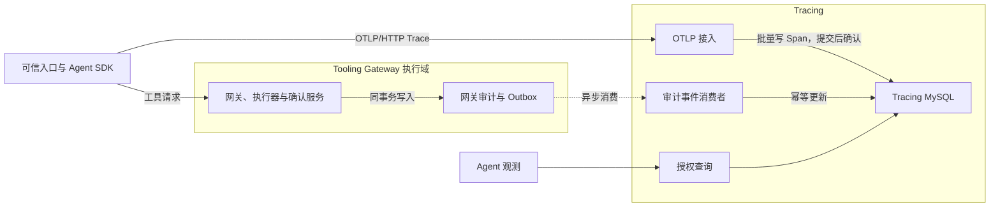

# Agent Tracing 系统架构

方案草案 · 2026-11-23

[系统架构图（在本地浏览器打开 HTML）](tracing-architecture.html)

## 1. 目标与一期范围

Agent 观测从会话列表进入，为开发者解释 Agent 如何运行，为安全管理员解释某次工具调用为何放行、拒绝或等待确认，以及平台能核实的实际执行结果。两类用户共享调用记录，按各自授权范围查询。

| 原型界面 | 一期数据契约 |
| --- | --- |
| Sessions 列表、搜索、时间分布 | 按 Session 开始时间、Agent、结果和关键字筛选。列表、总数和分布使用同一筛选口径。 |
| Session 详情 | 对话会话可含多个轮次。每轮一条 Trace。自主任务每次运行一条 Trace。只有一条时直接打开，多条时沿用详情容器按轮次切换。 |
| 时间线、调用树 | 同一批节点。时间线读取开始时间和耗时，调用树读取明确的父子关系。并行子 Agent 是同父节点下可时间重叠的分支。 |
| 调用详情 | Agent 节点显示运行元数据。LLM 显示模型、状态、耗时、可用的参数与 Token 用量。工具显示可信身份、网关决策、工具标识、策略版本、确认状态和执行证据。 |
| 工具调用与异常事件 | 以平台调用 ID 定位同一条 Trace 的工具节点。供网关审计页跳转。Trace 尚未同步或已过期时，用户仍可在网关审计页查阅原有证据。 |

一期先用网关调用打通查询和审计关联，再接 Agent SDK 补齐内部运行步骤。平台分别标明网关覆盖、已接入的 Agent 遥测和已知缺失。未观测到的内部步骤不生成节点；低覆盖也不降低安全决策或执行证据的可信度。财务演示的原文详情保留预置的合成样例并标记为模拟，由演示数据提供。生产 OTLP 和审计投影仍只保存结构化元数据。

**V1 外部上报范围。** Agent 和编排器统一通过鉴权的 `POST /v1/traces` 上报 OTLP/HTTP Trace。V1 接入范围到此为止，OTLP/gRPC、其他遥测信号和厂商专用上报协议留到有接入需求时评估。业务请求继续用 W3C Trace Context 传递上下文，平台审计通过网关自己的 Outbox 异步进入 Tracing。 [V1 接入决策](../adr/0001-v1-otlp-trace-ingest.md)

## 2. 方案选择

| 方案 | 适用性与成本 |
| --- | --- |
| 只用网关记录 | 足够核查经过网关的工具调用。模型调用、并行子 Agent、应用最终输出缺少来源，无法覆盖原型的详情。 |
| 第三方 Tracing 作为主后端 | 可以复用遥测接入和观测数据模型。网关审计归责、租户隔离以及待确认状态仍需由平台维护，两个数据面的查询和保留策略也需要协调。 |
| **推荐 · OTLP 接入 + 平台 Trace 读模型** | Agent 侧复用 OpenTelemetry 的 OTLP exporter，平台保留业务关联、证据归责和授权。首期直接写 MySQL，网关审计经独立后台消费者汇入。 |

Session／Trace／Span 的组织方式与 Langfuse 的 Session／Trace／Observation 对应。业务字段统一归一化，OTel 属性映射按版本测试，方便兼容 SDK 或后续对接外部观测后端。 [Langfuse 数据模型](https://langfuse.com/docs/observability/data-model) · [OpenTelemetry Span 规范](https://opentelemetry.io/docs/specs/otel/trace/api/)

## 3. 系统模块与写入流程

| 模块 | 责任与接口 |
| --- | --- |
| 业务关联 | 可信应用入口用 OTel SDK 建本轮根 Span，确定不变的 Trace 登记时间并签发短时效业务关联凭据。平台内部使用同一时间异步登记 Session、轮次和 Trace，SDK 开始导出前完成登记。凭据绑定租户、环境、项目、Session ID、根 Agent、轮次、Trace ID、Trace 登记时间及授权调用主体，网关依据可信签发方配置独立验签。业务入口在 Tracing 不可用时仍能签发关联凭据并分派工具请求。 |
| OTLP 接入 | SDK／编排器批报结束的 Span。接入验工作负载身份、Trace 归属和请求格式与大小，直接向 Tracing MySQL 写入可查询的结构化 Span。 |
| Tooling Gateway、执行器与确认服务 | 按各自职责产生服务端证据。鉴权后记录会话、发起用户或工作负载、Agent、委托关系及实际下游执行主体。策略决策与生效版本由网关写入，确认和执行结果由各自的事实源写入。 |
| 审计记录与 Outbox | 执行侧的权威事实。用同一事务记录业务状态转移、对应审计事件和待投影记录。原事件追加保存，修正通过新事件表达。 |
| 审计事件消费者 | 从网关侧内部 Outbox 接口拉取有版本的审计事件，处理重放、乱序和调用关联，把工具节点与消费去重记录写入 Tracing MySQL。 |
| 查询 | 按访问范围读取会话、Trace、调用节点以及关联证据引用。从 Tracing MySQL 组装调用树和时间线。控制台使用同一套查询视图。 |

**OTLP 持久化路径。**

1. SDK 在结束 Span 后异步批报。一个批次可以包含多条 Trace，接入端按生产者逐条核验可信登记及执行 Agent。SDK 等到可信登记成功再导出。查询登记失败时返回 OTLP/HTTP 503。权威记录不存在、超出接收窗口或生产者未获授权时永久拒绝该 Span。遥测接收窗口与业务关联凭据的有效期独立。试点可在可信终止或最长运行期结束后再收 48 小时，以两者中的较早截止时间为准。
2. 把通过校验的 Span 映射成结构化字段。一个数据库事务批量写入 `spans`，同步维护本批触及的 `sessions`、`traces` 时间和根状态索引字段。租户、环境、项目、Trace ID 和 Span ID 组成 InnoDB 唯一键。批量插入使用 `ON DUPLICATE KEY UPDATE` 保留已存在行，随后在同一事务用锁定读核对持久化记录。等价重传计为成功，来源或字段冲突时保留原记录并拒绝该 Span。只按已接受的记录更新会话和 Trace。其他写入错误按事务失败处理。
3. MySQL InnoDB 事务持久提交后，返回 OTLP 响应。接收库使用 `innodb_flush_log_at_trx_commit=1`，启用 binlog 时使用 `sync_binlog=1`。混合有效和永久拒绝的 Span 时，提交有效部分并报告拒绝数。数据库暂时不可用、事务因暂时性故障未提交或提交结果未知时返回 OTLP/HTTP 503，SDK 重发时按同一键去重。V1 只持久化可查询的结构化记录，接收请求体不另做归档，也无需 OTLP 暂存表或消息队列。SDK 缓冲耗尽或退出时仍可能丢失未成功发送的遥测。

[OTLP/HTTP 投递与确认](https://opentelemetry.io/docs/specs/otlp/#otlphttp) · [MySQL 唯一键冲突](https://dev.mysql.com/doc/refman/8.4/en/insert-on-duplicate.html) · [InnoDB 提交持久性](https://dev.mysql.com/doc/refman/8.4/en/innodb-parameters.html#sysvar_innodb_flush_log_at_trx_commit)

**网关执行路径。** 网关生成平台调用 ID，持久化决策，允许执行时还要在实际转发前持久化执行意图。确认挂起时，确认记录保存调用 ID 和原 Trace 上下文；之后以锁定的参数、当前授权和有效期复验，领取成功后生成执行尝试。只读调用也记录放行和结果。Tracing 停机时，网关仍执行自己的鉴权、策略与审计，Outbox 可积压并重放。网关自己的必需审计写入不可用时，网关对尚未发出的调用返回暂不可用，禁止转发并触发监控；已发出的调用可能只能标为结果未知并待对账。工具执行和数据库事务跨系统，按调用 ID 保存和查询执行尝试。副作用调用要求提供逻辑请求幂等键，平台在首次接收并完成身份校验后原子写入幂等占位、平台调用 ID 和首条审计事件，先于创建确认单或转发，按租户、环境、项目、已认证调用主体和该键去重，绑定原操作版本及规范化参数摘要。并发或超时后的同键重传返回同一个调用 ID 和状态；同键换参数或操作返回冲突。重传读取状态仍需鉴权。幂等记录从调用开始覆盖客户端重试窗口、确认有效期及结果未知的对账窗口，生命周期由执行侧管理。只有下游明确支持幂等及结果查询时才可用原调用 ID 按其契约恢复，其他情况保留未知并人工核验。

**审计异步接入。** 网关、确认与执行模块在执行侧持久化业务记录、审计事件及 Outbox。Tracing 后台消费者经服务身份鉴权，按租约调用网关侧内部事件接口读取待处理项，在 Tracing 库事务内写入工具节点和按来源、事件 ID 去重的消费记录，然后确认该项。租约到期或确认丢失可重放。事件包含版本、服务端归属、可信关联及凭据中的 Trace 登记时间、调用 ID、来源、对象序号、决策或执行状态及证据引用。网关运行路径无需访问 Tracing 服务或数据库，Tracing 查询也从本库完成；原始审计仍由网关持有和授权查询。

**异步确认。** 平台审计事件独立于 SDK 上报窗口。确认服务从确认单恢复原 Trace 及调用 ID 并记录确认事实。网关记录复验，执行器记录执行结果，均沿用原关联。调用有待确认或活跃对账时，保留原 Trace 的最小元数据和证据关联，截至确认或对账窗口结束后 7 天与常规元数据留存截止日两者中的较晚日期。确认和对账窗口由平台策略配置有限的期限。超期到达的审计证据仍按原调用 ID 查阅，已过期或主动删除的 Trace 不重新生成。

**关联路径。** 网关先完成身份校验，再独立验签并核对业务关联凭据的归属、有效期与调用主体。`traceparent` 格式有效且 Trace ID 与凭据绑定一致时，才采用它提供的父节点 ID。头字段缺失、无效或不匹配时，在已验证的 Trace 下保留网关证据，忽略外来父节点信息。只接网关且已有可信会话和轮次时，网关为该轮创建 Trace ID 并随事件传递。Tracing 可用经内部接口认证的网关事件建立缺失的 Session 和 Trace 元数据。SDK 上报仍须单独匹配可信入口登记的生产者。若可信会话存在但轮次不可用，每个独立调用创建一条 Trace。若会话也不可用，按已认证调用生成独立的网关会话，杜绝按时间或展示名猜测归并。未认证请求记录在网关安全日志，缺少可信归属时无需生成会话。跨组织信任边界时重启追踪上下文，禁止向未经允许的外部端点透传内部业务关联标识。 [W3C Trace Context](https://www.w3.org/TR/trace-context/)

## 4. 数据模型与运行语义

所有观测记录以服务端确定的 `tenant_id`、`environment_id` 和 `project_id` 为隔离范围。会话归属单一项目，项目内根 Agent 和会话在首条可信登记时确定。不同项目之间的运行分别建立 Trace，一期只在各自项目内展示节点。MCP 协议会话 ID 与业务会话 ID 分开。

| 对象 | 关键字段与不变量 |
| --- | --- |
| Session | 平台 `session_id`、根 Agent、发起用户或工作负载、开始与末次活动时间、可见调用数、结果摘要、覆盖来源。开始时间由可信入口登记，纯网关会话取服务端首次登记时间，写入后固定，迟到记录不修改。外部会话引用按可信入口命名空间管理。 |
| Trace | `trace_id`、`session_id`、`turn_id` 或 `run_id`、起止时间、应用运行状态、治理摘要、覆盖状态。业务绑定在所属项目内唯一。可另存来自可信入口的 `task_id`／`correlation_id`，用于在授权范围内关联同一业务任务的多轮运行。 |
| Span | `trace_id`、`span_id`、`parent_span_id`、类型、时间、来源、可核验的执行 Agent、状态与安全元数据。SDK Span 记录 Agent、LLM 和客户端调用。网关工具主节点按 `call_id` 生成，使用与 SDK Span 分离的内部节点标识。 |
| Tool Call | 平台 `call_id`、可信 Trace 与网关节点引用、工具及操作版本、发起用户或工作负载、Agent、委托链与实际下游执行主体、授权 ID/权限 epoch、凭证引用和受众、资源或目的地的结构化标识、策略产生的分类标签、决策与原因码、命中策略版本、确认单 ID。凭证引用不含秘密。一个调用可有多次执行尝试。 |
| Confirmation | `confirmation_id`、`call_id`、状态、有效期、确认人及动作时间。原 Trace 引用随确认单保存。 |
| Execution Attempt | `attempt_id`、`call_id`、下游请求引用、执行状态、后端回执或独立对账证据引用及来源。财务 Demo 以原付款调用 ID 关联测试付款端的入站记录和测试交易。 |
| Audit Event | `event_id`、事实源、`call_id`、可选 `attempt_id`、事件类型、源端序号、发生和接收时间、状态及证据引用。原始事件与投影独立保留。 |

- **去重。** SDK Span 初次写入时固定生产者，同键且同来源的等价重传视为成功。同键来源不同或数据冲突时保留原记录。网关审计事件按事实源和事件 ID 去重，只有目标事务提交后才确认 Outbox。
- **工具调用从网关审计生成。** SDK 从工具客户端 Span 注入 `traceparent`，并将网关回传的 `call_id` 写到该 Span。关联要求可信 Trace、发起 Agent、调用 ID 一致，且网关保存的 `traceparent.parent-id` 等于 SDK 客户端 Span 自身的 `span_id`。匹配后将客户端耗时补到网关工具节点，节点挂在 SDK 客户端 Span 的 `parent_span_id` 下。两路记录均可先到，未匹配的网关工具节点仍可查询。网关经过策略、确认和执行的事实以内部事件为准，SDK 数据不能写入这些字段。只有 SDK 时仍可显示客户端观测，标明证据未同步或未观测到网关；受管工具计数按可见的网关 `call_id` 去重。

- **建树和时间。** 父节点迟到时先将已接收节点显示在未关联区，之后自动归并；父节点限同一 Trace，并拒绝自引用和环。跨 Trace 的独立运行使用 Trace Links，查询时对两端分别检查访问范围。时间线用来源提供的 UTC 时间排序，用同一进程的耗时计量确定节点宽度。跨进程时钟偏差时保留原始记录并标识。Trace 耗时使用根运行区间，根缺失时只显示已观测时间区间；并行耗时不累加。 [OpenTelemetry Trace 模型与 Links](https://opentelemetry.io/docs/specs/otel/overview/)
- **决策、执行和运行状态分别归责。** `decision` 记录允许、拒绝、阻断或待确认；`execution` 记录未执行、执行中、成功、失败或未知；`run_state` 来自 Agent 或可信入口的运行事件。收到了拒绝且无后续执行权限时可标为未执行；网络超时、结果回执缺失时标为未知。独立的 `confirmation_state` 由确认服务维护，包含待确认、已确认、已拒绝、已过期。确认同意后，网关另写复验结果，执行器按尝试写执行结果。同一事实源内用对象序号归并；跨来源用确认单、调用与尝试关系及状态机推导，保留原始决策。
- **摘要与覆盖分开。** 列表结果和结果筛选使用同一个字段。只看当前读者可见且留存期内的事实，依次取已阻断、已拒绝、仍待确认。复验阻断或拒绝以网关事实为准，确认拒绝或过期归入已拒绝。只有确认单当前为待处理时才计作待确认。没有以上结果时，显示最近一条可见 Trace 的运行状态。只有可信运行事件可标记 Agent 已完成；仅有网关时展示工具执行状态并标明网关覆盖。调用数按可见平台调用 ID 去重，耗时取最近一条可见 Trace 的根运行耗时，无根时标明观测范围。显式检测到丢失、仍缺父节点或接收失败等情况时标为部分可见。结束事件也不证明采集完整。迟到的 SDK 遥测在允许的接收窗口内更新现有视图。元数据留存期内，晚到的平台审计仍按原调用更新视图。

**例子。** 一轮客服对话先调用 LLM，再并行启动订单和客户资料两个子 Agent。各分支的网关查工具有独立 `call_id`。之后规划出发送邮件，网关持久化阻断及策略版本，没有转发到后端。结果可以同时显示 Agent 已完成回复、会话治理摘要已阻断、邮件未执行。仅接网关时，同一轮能看到有可信归属的工具节点及决策。

## 5. 查询、权限与存储

| 查询接口 | 返回与约束 |
| --- | --- |
| `GET /v1/observability/sessions` | 按 `from,to,agent_id,result,q,tz,cursor` 查询，时间窗默认 7 天、上限 30 天。Agent 和结果支持多选，同类选项取并集、不同条件取交集。搜索匹配 Session ID 或 Agent 名称；筛选选项限定在访问范围，Agent 选项来自所查时间窗内可见会话。时间条件按 Session 开始时刻，区间为 `[from,to)`。时间桶按请求时区边界生成。列表、总数、分布在同一个 InnoDB `REPEATABLE READ` 只读事务内按同一授权和筛选条件计算。分页按 `started_at DESC, session_id DESC`，游标签名绑定过滤条件与授权范围；翻页之间状态可随投影更新。 [InnoDB 一致性读](https://dev.mysql.com/doc/refman/8.4/en/innodb-consistent-read.html) |
| `GET /v1/observability/sessions/{id}/traces` | 按轮次或运行开始时间返回 Trace 摘要，支持游标分页。 |
| `GET /v1/observability/traces/{id}` | 返回时间范围、覆盖、治理摘要、紧凑节点集、节点 ID 及父子关系。超过单响应预算时使用明确的分段游标并标识未加载节点，父节点占位用结构标记表达。 |
| `GET /v1/observability/traces/{id}/nodes/{node_id}` | SDK Span 和网关工具节点使用同一详情接口，`node_id` 由 Trace 详情返回。响应按类型提供元数据、决策和证据引用。生产 Trace 的模型和工具原文字段标记为未采集。 |
| `GET /v1/observability/tool-calls/{call_id}/trace` | 按本地索引返回可访问的工具节点深链。投影未就绪、已过期或不可见时统一返回不可用，网关审计页继续显示自己持有的证据。 |

列表返回对象的租户、环境和项目范围。详情及工具深链请求带上完整范围和对象 ID，例如 `GET /v1/observability/traces/{id}?tenant_id=…&environment_id=…&project_id=…`。服务端先校验请求中的范围获授权，再用完整组合定位对象。

**读权限。** 使用服务端身份与项目/Agent 授权求交，再检查环境、节点与证据权限。开发者需有根 Agent 权限才能进入会话，并对不同执行 Agent 的节点逐一鉴权。无法核验归属的节点只向有该项目或租户观测权限的安全管理员开放。先过滤节点和证据，再计算摘要、计数和筛选项，隐藏父节点的标识和占位信息，仍可见的子节点挂到无归属信息的视图根层。节点被授权过滤也不对读者暴露缺失原因或数量。安全管理员按获授权项目或租户看治理事实。越权深链返回与不存在相同的响应，筛选选项、分布与计数也必须应用授权。租户、环境、项目和 Agent 的行级隔离由 Tracing 服务的数据访问层执行。每次查询从服务端授权上下文取得允许的范围组合，作为参数传入 SQL；通过 ID 查找、筛选和聚合均带上同一授权范围。跨表关联同时等值匹配租户、环境、项目和对应对象 ID。MySQL 账号按职责授予库表权限，查询账号只有读取权限。 [MySQL GRANT](https://dev.mysql.com/doc/refman/8.4/en/grant.html)

**V1 数据范围。** 接入只存类型受限的结构字段，例如 Span ID、时间、状态枚举、Token 数及配置或可信目录中的模型与工具标识。SDK 配置仅导出约定的结构字段。未知标识和自由文本值不落库，错误仅存原因码，证据仅存可信引用 ID。接入、数据库和 Tracing 日志不保留原始 OTLP 请求体、任意属性、Prompt、模型回复或工具参数与返回值。V1 不建设实时脱敏、内容采集和按租户或 Agent 的业务限流。保留鉴权、归属验证、协议格式校验及 OTLP 请求体大小上限，大小上限涵盖解压后的请求。

**存储与留存。** V1 的 Tracing 使用 MySQL InnoDB，用同一套关系表和索引完成事务写入、Session 筛选与 Trace 回查。V1 无需独立观测存储或消息队列。执行领域和 Tracing 各自管理数据库与访问账号。若执行侧也采用 MySQL，财务 Demo 可共用实例，分别使用独立数据库、账号和连接池，共用实例停机时两边均受影响。要求 Tracing 库故障不影响网关执行的环境，两边使用独立实例。Session 按租户、环境、项目、开始时间和 ID 索引，Trace/Span 按归属、Trace 与父节点索引，工具深链按归属和平台 `call_id` 索引。Trace ID 和 Span ID 按解码后的字节存储，其他不透明 ID 按上游规定的等值语义存储，避免默认文本排序规则合并不同 ID。试点建议元数据从可信入口原始登记时间起留存 30 天，纯网关 Trace 从网关侧首次登记时间起算。事件首次延迟到达也沿用该时间。活跃确认及对账按前述规则延长最小记录留存。网关自己的审计按其政策保留。旧 Trace 到期后从 Session 摘要移除，最后一条到期后移除 Session 视图。迟到事件和重放遵守原有到期时间及删除标记。删除记录的保留期覆盖可恢复备份及事件重放窗口，恢复时从独立保留的删除增量补齐标记，再开放查询和重放。 [V1 存储与接入边界](../adr/0002-v1-tracing-mysql-and-gateway-audit.md)

## 6. 可靠性与验收

首期采集、审计消费和查询可在同一 Tracing 后端交付。审计消费者在后台独立运行，监控最老未确认事件、重试和投影失败。OTLP 接入监控写入延迟、数据库失败与拒绝数。数据库过载或不可用时，按 OTLP 返回可重试错误。网关审计不采样，观测故障时事件在网关侧保留。

建议以每天 50 万 Span、峰值 100 Span/秒、30 天元数据留存作为首轮压测输入。按每 Span 2 KiB 粗估，30 天约 29 GiB 逻辑 Span 数据，实际需加上索引、写放大、审计投影及备份。首轮验证目标为 P95 审计投影可见延迟 ≤5 秒、常规列表读取 ≤800 毫秒、1,000 节点内 Trace 读取 ≤1 秒。均为待压测的提案。用真实负载压测后，再决定是否调整索引、分区或拆分分析存储。

| 验收场景 | 验收条件 |
| --- | --- |
| 真链路 | 财务 Demo 展示合成 LLM 节点、查账和付款；阻断及待确认时下游零请求，确认后由独立测试后端记录核对实际执行，Trace 跳回同一次调用。 |
| OTLP 接入 | 工作负载已鉴权且 Trace 已可信登记时，标准 OpenTelemetry OTLP/HTTP exporter 可向 `POST /v1/traces` 批量发送 Trace，接收符合 OTLP/HTTP 规范的响应，节点可在控制台查询。OTLP/gRPC、指标、日志等其他遥测信号及厂商专用上报请求无法通过 V1 Tracing 接入。 |
| 拓扑与关联 | 多轮同 Session、并行 Agent、乱序父节点、重复上报、缺失 SDK 及错误关联均可稳定展示。确认拒绝、过期或复验失败后，列表更新治理摘要。执行完成后，详情展现实际执行结果，历史决策仍可查。父上下文的 Trace ID 与可信登记不匹配时，网关证据仍归入已验证的 Trace，且不挂到外来的父节点。SDK Span 和审计事件无论谁先到，匹配后均归并到同一网关工具节点并挂到同一父节点。相同事件重放后计数与审计引用一致。 |
| 可靠写入 | 在隔离部署中，停 Tracing 服务或其数据库，网关工具调用与本地审计继续。恢复后重放 Outbox，工具节点只出现一次。模拟 OTLP 提交失败及提交后断连，确认成功响应只发生在提交后，重传不重复写 Span。并发同键重传不覆盖原记录，其他写入错误触发事务失败。停执行侧审计写入时禁止新转发，执行结果未知时保持原调用 ID 待核验。 |
| 访问与数据范围 | 列表、计数、聚合和深链均应用租户、环境、项目及 Agent 权限。同一读者同时获准访问两个包含相同外部 ID 的项目时，指定项目的详情与深链定位唯一对象，关联、聚合与计数保持项目隔离。SDK 误报原文、任意属性或把自由文本塞入标识字段时，Tracing 只保存约定的结构值，且不记录请求体。 |
| 生命周期 | 超过 SDK 上报窗口的确认与执行仍可回到原调用。迟到事件按来源顺序归并，拒绝和成功记录同时保留；重放或备份恢复不复活删除记录。 |

上线依次验证 OTLP 直写、独立网关审计消费、父子拓扑和多轮会话。真实负载、客户留存要求和允许接入的生产 Agent 范围需在上线前确认。
